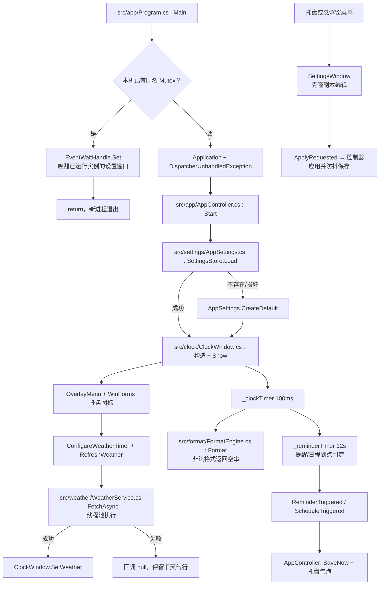

# 系统架构与模块契约

记录 GameClock 的运行架构、启动链、模块边界，以及跨模块调用的参数、返回值与失败语义。读者为维护者与二次开发者。

## 目录

- [1. 概述](#1-概述)
- [2. 执行流程图](#2-执行流程图)
- [3. 对外 API 参数](#3-对外-api-参数)
- [4. 方法传参](#4-方法传参)
- [5. 代码路径](#5-代码路径)
- [6. 相关文档](#6-相关文档)

## 1. 概述

GameClock 是单进程、单 UI 线程的 WPF 桌面应用（托盘部分用 WinForms）：`AppController` 负责编排，窗口与设置界面负责表现，`format` / `reminders` / `weather` 提供能力，`platform` / `theme` 提供基础设施。模块之间以事件和同步方法调用协作，状态通过 JSON 文件持久化。

设计取舍：

- **单一命名空间 `GameClock`**：模块靠目录与类型名区分，不按模块拆命名空间。理由是全仓已有大量 `using GameClock` 式同命名空间引用，拆分会产生连锁改动；代价是缺少编译期的模块边界约束，需靠本文件的模块契约与代码评审维持。
- **事件驱动的窗口协作**：悬浮窗只捕获输入并上抛 `MenuRequested`、`PositionChanged`、`ReminderTriggered`、`ScheduleTriggered`，由控制器决定保存、弹菜单或提示，避免窗口反查控制器。
- **设置副本编辑**：设置窗口编辑 `AppSettings.Clone()` 的副本，只有提交（`ApplyRequested`）后才由控制器写回并保存，取消不污染运行态。
- **失败降级优先**：配置损坏回退默认值、天气失败保留旧文本、格式非法显示空串，保证悬浮窗本身始终可用。

模块职责与边界：

| 模块 | 目录 | 职责 | 主要依赖 |
| --- | --- | --- | --- |
| app | `src/app/` | 进程入口、单实例、异常兜底、托盘、菜单、定时刷新与防抖保存 | clock、settings、weather、platform |
| clock | `src/clock/` | 悬浮窗绘制、拖动、置顶/穿透、提醒气泡与到点检查 | format、reminders、platform、settings（模型） |
| format | `src/format/` | 时间/天气文本渲染、简洁变量、农历干支、时区目录 | weather（`WeatherInfo` 类型） |
| platform | `src/platform/` | Win32 P/Invoke、开机自启注册表 | 无 |
| reminders | `src/reminders/` | 提醒/日程模型、预设、到点判定、提示音 | format（时间规范化） |
| settings | `src/settings/` | `AppSettings`、JSON 持久化、设置窗口五页签、日程编辑弹框、关于窗口 | reminders、format、weather、theme |
| theme | `src/theme/` | 暗色主题、滚动条、字体目录、SVG 图标 | 无（仅 WPF/WinForms 类型） |
| weather | `src/weather/` | Open-Meteo 地理编码/天气/空气质量、ipify 公网 IP | 无 |

线程模型：

- UI 线程：窗口、托盘、`DispatcherTimer`（时钟 100 ms、置顶维护 3 s、提醒检查 12 s、悬停 150 ms、防抖保存 550 ms、天气按配置分钟）。
- 线程池：`WeatherService.FetchAsync` 抓取网络数据，回调在后台线程；调用方负责切回 UI。
- 后台监听线程：`Program` 中等待命名事件 `Local\GameClockOverlay.ShowSettings`，收到后经 `Dispatcher.BeginInvoke` 回到 UI 打开设置。

主要失败策略：

| 场景 | 行为 |
| --- | --- |
| 设置文件缺失/为空/反序列化失败/无权限 | `SettingsStore.Load` 返回 `AppSettings.CreateDefault()`，不抛异常 |
| 设置保存失败 | `SettingsStore.Save` 返回 `false`，临时文件在 `finally` 清理 |
| 天气抓取/解析失败 | 回调 `WeatherInfo = null`，悬浮窗保留上一次天气文本 |
| 格式串非法 | `FormatEngine.Format` 返回 `string.Empty` |
| 未处理异常 | `DispatcherUnhandledException` 写 `%APPDATA%\GameClock\error.log` 并弹窗；启动失败同样弹窗后退出 |

## 2. 执行流程图

## 3. 对外 API 参数

无，GameClock 是单机桌面程序：不监听端口、不导出 HTTP/RPC 接口、不提供命令行参数。命名事件 `Local\GameClockOverlay.ShowSettings` 只用于本机同名进程唤醒设置窗口，不构成对外协议。

程序主动发起的出站请求如下，均无鉴权、无 API Key，超时 10 s（`HttpWebRequest.Timeout` / `ReadWriteTimeout`），`User-Agent` 为 `GameClock/1.0 (weather overlay)`：

| 服务 | 端点 | 方法 | 关键参数 | 用途 |
| --- | --- | --- | --- | --- |
| Open-Meteo 地理编码 | `https://geocoding-api.open-meteo.com/v1/search` | GET | `name=<城市名>&count=1&language=zh&format=json` | 非内置城市转经纬度 |
| Open-Meteo 预报 | `https://api.open-meteo.com/v1/forecast` | GET | `latitude`、`longitude`、`current=temperature_2m,weather_code,relative_humidity_2m,wind_direction_10m`、`daily=weather_code,temperature_2m_max,temperature_2m_min`、`timezone=auto`、`forecast_days=6` | 当前天气与 6 天预报 |
| Open-Meteo 空气质量 | `https://air-quality-api.open-meteo.com/v1/air-quality` | GET | `latitude`、`longitude`、`current=us_aqi`、`timezone=auto` | 格式含 AQI 变量时取 AQI |
| ipify | `https://api.ipify.org?format=json` | GET | 无 | 格式含 `ip` 变量时取公网 IP，缓存 6 小时 |

内置 14 个城市的中英文坐标（北京、上海、广州、深圳、杭州、成都、重庆、武汉、西安、南京、天津、苏州、长沙、郑州），命中时跳过地理编码。

## 4. 方法传参

跨模块调用与关键入口的契约：

| 方法（路径） | 签名 | 参数与返回 | 失败语义 / 副作用 |
| --- | --- | --- | --- |
| `Program.Main`（`src/app/Program.cs`） | `private static void Main()` | 无参、无返回 | 已有实例时发事件后退出；启动异常弹窗并关闭；创建 Mutex/EventWaitHandle/监听线程 |
| `AppController.Start`（`src/app/AppController.cs`） | `public void Start()` | 无参、无返回 | 读设置、按 `StartWithWindows` 写自启、建窗口/托盘/定时器并立即刷新天气；异常上抛给 `app.Startup` 兜底 |
| `SettingsStore.Load`（`src/settings/AppSettings.cs`） | `public static AppSettings Load()` | 返回设置对象，已 `Normalize` | 文件缺失、空文件、`IOException`、`UnauthorizedAccessException`、`SerializationException`、`ArgumentException` 一律返回默认设置，不抛 |
| `SettingsStore.Save`（`src/settings/AppSettings.cs`） | `public static bool Save(AppSettings settings)` | `settings` 为 `null` 返回 `false`；成功返回 `true` | 先写 `settings.json.tmp` 再 `File.Replace`，失败回退删除+移动；IO/权限/序列化失败返回 `false`，临时文件必清理 |
| `ClockWindow` 构造（`src/clock/ClockWindow.cs`） | `public ClockWindow(AppSettings settings)` | `settings` 为 `null` 时用默认值并 `Normalize` | 无异常；初始化 100 ms/3 s/12 s/150 ms 四个定时器与鼠标事件，立即 `UpdateClock(true)` |
| `ClockWindow.ApplySettings` | `public void ApplySettings(AppSettings settings)` | `settings` 为 `null` 直接返回；否则应用并 `Normalize` | 首次加载前只刷视觉与天气；之后重设时区、透明度、置顶、提醒显示与 Win32 样式，并异步 `EnsureVisible` + `CapturePosition` |
| `ClockWindow.SetWeather` | `public void SetWeather(WeatherInfo info)` | `info` 允许为 `null` | 仅更新缓存并重绘天气行，不抛异常 |
| `ClockWindow.ShowReminderPreview` | `public void ShowReminderPreview(string time, string message)` | `message` 空白直接返回；`time` 无法规范化为 `HH:mm` 时保留原文本，空则显示 `--:--` | 把预览提醒入队，由提醒定时器展示；不写设置 |
| `FormatEngine.Format`（`src/format/FormatEngine.cs`） | `public static string Format(DateTime time, WeatherInfo weather, string format)` | `weather` 可为 `null`；返回渲染文本（可含一个换行） | `format` 为空或解析失败返回 `string.Empty`；天气 token 在无数据时渲染为空；折叠空行 |
| `WeatherService.FetchAsync`（`src/weather/WeatherService.cs`） | `public static void FetchAsync(string city, WeatherFetchOptions options, Action<WeatherInfo> callback)` | `city` 空白按「北京」；`options` 为 `null` 用默认；`callback` 为 `null` 立即返回 | 线程池执行；抓取/解析失败仍回调，`WeatherInfo` 为 `null`；回调自身异常被吞掉 |
| `ScheduleService.TryFindDueOccurrence`（`src/reminders/Schedule.cs`） | `public static bool TryFindDueOccurrence(ScheduleItem item, DateTime now, out DateTime occurrence)` | `item` 为 `null`、日期/时间不可解析返回 `false` | 触发窗为 `[occurrence - advanceMinutes, occurrence + 30min]`；年度日程在 `now.Year ± 1` 找候选；`true` 时 `occurrence` 为计划时刻 |
| `ScheduleService.GetOccurrenceKey` | `public static string GetOccurrenceKey(DateTime occurrence)` | 返回 `yyyy-MM-dd HH:mm` | 作为 `ScheduleItem.LastTriggeredKey` 的去重键，写入后不再重复触发 |
| `ReminderModes.AppliesToState`（`src/reminders/Reminder.cs`） | `public static bool AppliesToState(string reminderMode, string currentState)` | 两个参数均先归一 | 判断提醒是否适用于当前工作/娱乐状态；未知模式按默认处理 |
| `SettingsWindow` 构造（`src/settings/SettingsWindow.cs`） | `public SettingsWindow(AppSettings current)` | `current` 为 `null` 用默认设置 | 克隆副本 `_working` 并 `Normalize`；编辑不直接改运行态；`Result` 返回副本，提交由 `ApplyRequested` 事件通知 |
| `AutoStartManager.SetEnabled`（`src/platform/AutoStartManager.cs`） | `public static bool SetEnabled(bool enabled)` | 返回是否写入成功 | 增删 `HKCU` Run 项；无权限等失败返回 `false`，不抛 |

## 5. 代码路径

| 内容 | 路径 |
| --- | --- |
| 程序入口 / 单实例 / 异常兜底 | `src/app/Program.cs` |
| 启动编排 / 托盘 / 菜单事件 / 防抖保存 | `src/app/AppController.cs` |
| 共用右键菜单 | `src/app/OverlayMenu.cs` |
| 悬浮窗与提醒/日程到点检查 | `src/clock/ClockWindow.cs` |
| 阴影与 3D 文字 | `src/clock/LayeredText.cs` |
| 设置模型 / 持久化 / 颜色工具 | `src/settings/AppSettings.cs` |
| 设置窗口五页签（`partial`） | `src/settings/SettingsWindow*.cs` |
| 日程编辑弹框 / 关于窗口 | `src/settings/ScheduleEditorWindow.cs`、`src/settings/AboutWindow.cs` |
| 时间格式 / 简洁变量 / 时区 | `src/format/TimeFormatter.cs`、`src/format/FormatEngine.cs`、`src/format/TimeZoneCatalog.cs` |
| 提醒与日程模型 / 到点计算 | `src/reminders/Reminder.cs`、`src/reminders/Schedule.cs` |
| 天气与公网 IP | `src/weather/WeatherService.cs` |
| Win32 / 开机自启 | `src/platform/NativeMethods.cs`、`src/platform/AutoStartManager.cs` |
| 构建脚本 / 构建输入 / 产物 | `build.ps1`、`build/`、`dist/` |
| 用户设置 / 错误日志 | `%APPDATA%\GameClock\settings.json`、`%APPDATA%\GameClock\error.log` |

## 6. 相关文档

- `docs/000000-全库总索引.md`
- `docs/300000-架构与模块.md`
- `AGENTS.md`
- 模块自述：`src/app/Readme.md`、`src/clock/Readme.md`、`src/format/Readme.md`、`src/settings/Readme.md`、`src/reminders/Readme.md`、`src/weather/Readme.md`、`src/platform/Readme.md`、`src/theme/Readme.md`
- 用户说明：`README.md`
